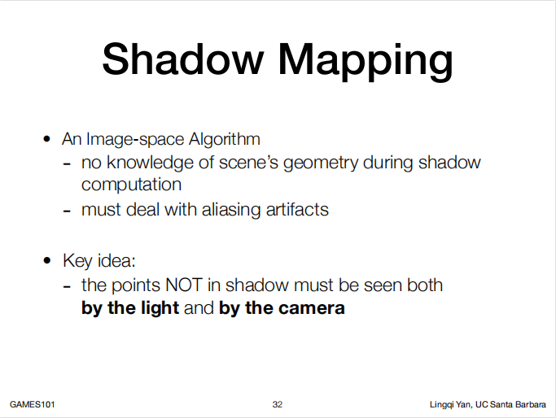
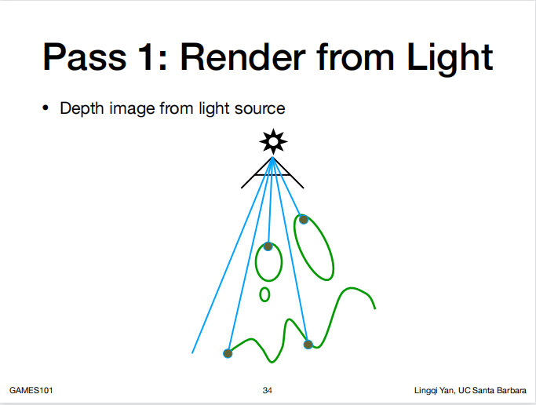
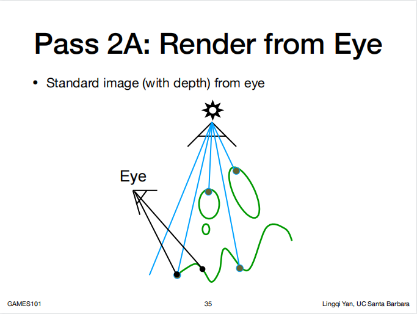
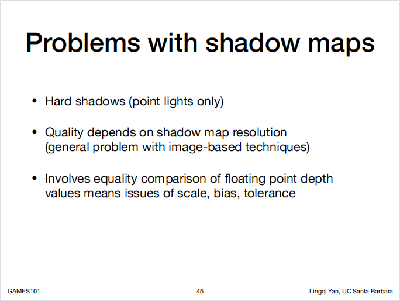

# Shadow Mapping

Shadow Mapping 可以用于方向光、聚光灯和点光源。全向点光源一般需要覆盖多个方向的深度图。

## 从光源渲染

从光源看向场景，记录下每个像素的深度。

# 从相机渲染

将相机能看到的点投影回光源，可以了解点对应在上一步生成的深度图中的哪个像素。

比较当前点的光源空间深度和深度图记录的最前表面深度。在常规的深度约定下，前者超过后者加上偏移量时，当前点才处在阴影中。

# 缺点

