# 辐射度量学——概念

光照的衡量方法。

给光各种空间中的属性。

在物理上准确地定义光照地方法。

# 物理量

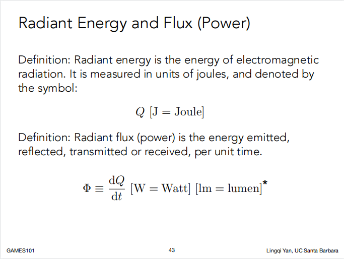

Radiant Energy：电磁辐射的能量。符号是Q，单位是焦耳。

Radiant Flux（辐射通量）是单位时间发射、反射、传输或吸收的辐射能量，符号为 Φ，单位为瓦特（W）。对应的光度学量是光通量，单位为流明（lm）。

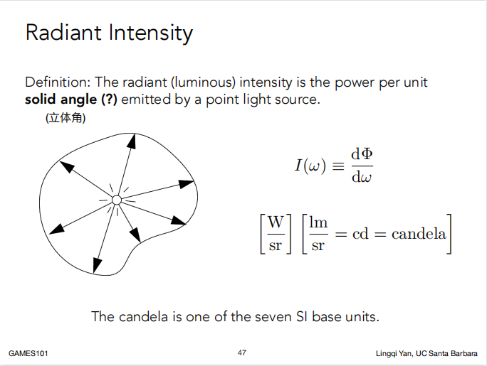

Radiant Intensity:光源在单位时间内在单位立体角发出的光的能量。相当于单位方向上的光强度/功率。符号是I。

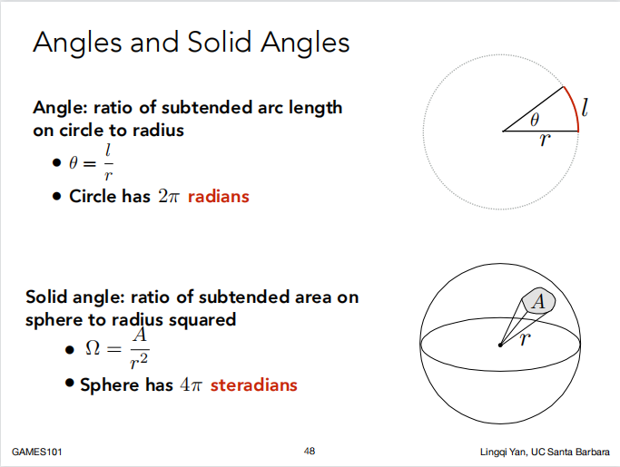

立体角是角度在三维的延申，立体角的大小是弧面面积/半径的平方，符号是ω。

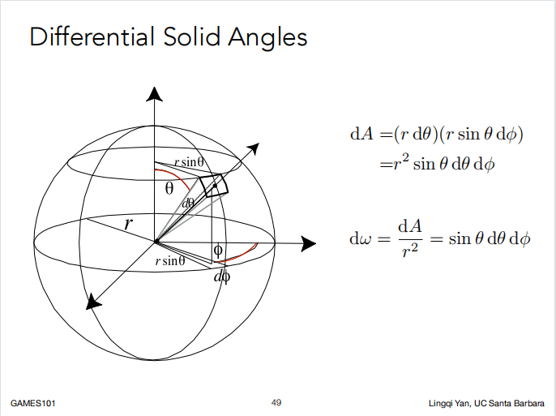

微分立体角描述极角 θ 和方位角 φ 附近的一小束方向。θ 是与极轴的夹角，φ 是垂直于极轴的平面内的方位角。

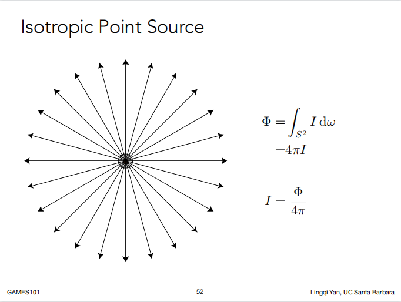

各向同性的点光源情况下，总的Intensity和Flux的换算，整个球面的立体角是4*pi。

以及I(ω)=dΦ/dω。

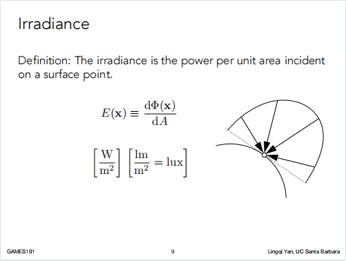

Irradiance：单位面积的功率(Flux)(不管是吸收的还是反射的，就是不考虑怎么用，单纯收到的所有能量)

E(x)=dΦ(x)/dA，单位是 W/m²。对应的光度学量是照度，单位是 lx（lm/m²）。

### Irradiance Fallout

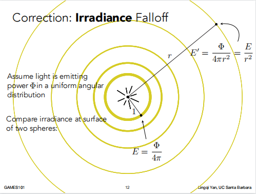

### Radiance

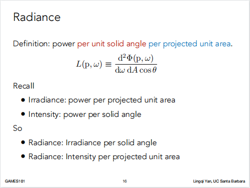

Radiance（辐亮度）是沿某个方向传播的辐射通量，除以该方向的微分立体角和垂直于该方向的投影面积。

符号是 L，单位是 W/(m²·sr)。对应的光度学量是亮度，单位是 cd/m²（nit）。

### Incident Radiance

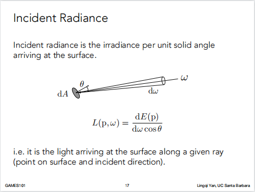

沿某个方向入射、按单位投影面积和单位立体角计量的辐射通量。

### Exiting Radiance

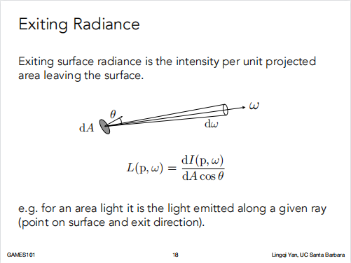

沿某个方向出射、按单位投影面积和单位立体角计量的辐射通量。

### Irradiance和Radiance对比

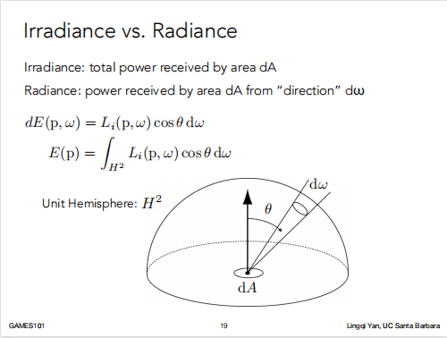

Irradiance 是入射辐亮度在入射半球上的加权积分：$E=\int_{\Omega^+} L_i\cos\theta\,d\omega$。余弦因子来自面积投影。

Radiance 带有方向。Irradiance 把入射方向按余弦权重积分，得到表面该点接收到的通量密度。

