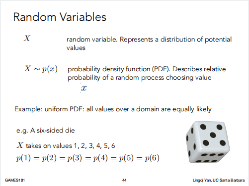
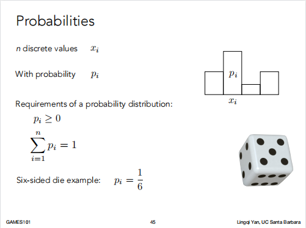
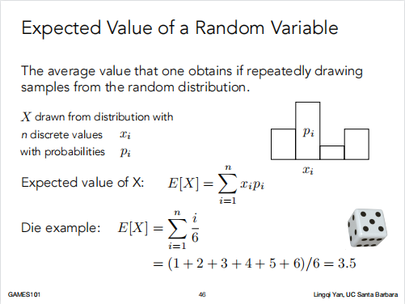
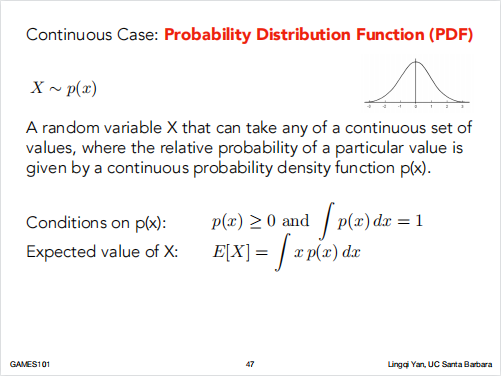
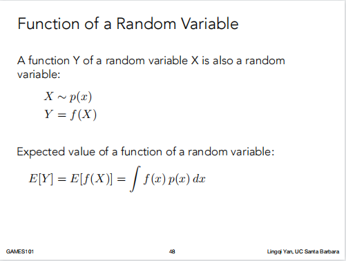

# 随机变量

随机变量表示潜在值的分布。

离散随机变量的概率质量函数（PMF）给出每个取值的概率。比如公平六面骰子的每个点数都以 1/6 的概率出现。

# 概率

# 期望

期望是所有可能的值的加权平均，权值是随机到这个值的概率。

# 连续的情况

连续随机变量在区间内的概率等于其概率密度函数（PDF）在该区间上的积分。累积分布函数（CDF）表示 $P(X\le x)$，离散随机变量也有 CDF。

## 求函数的期望

把原来的变量x替换成函数f(x)即可。