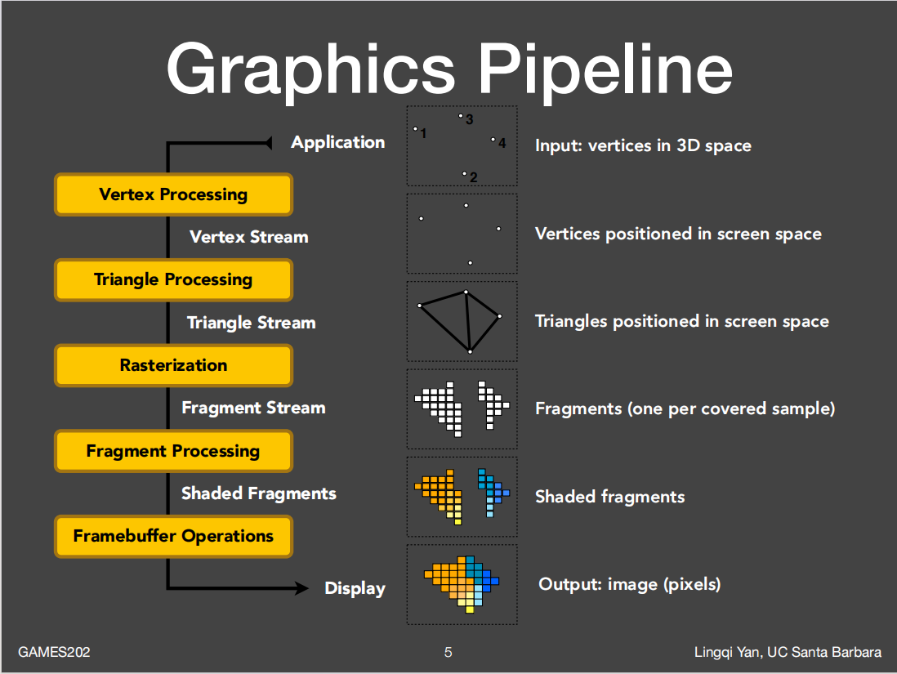
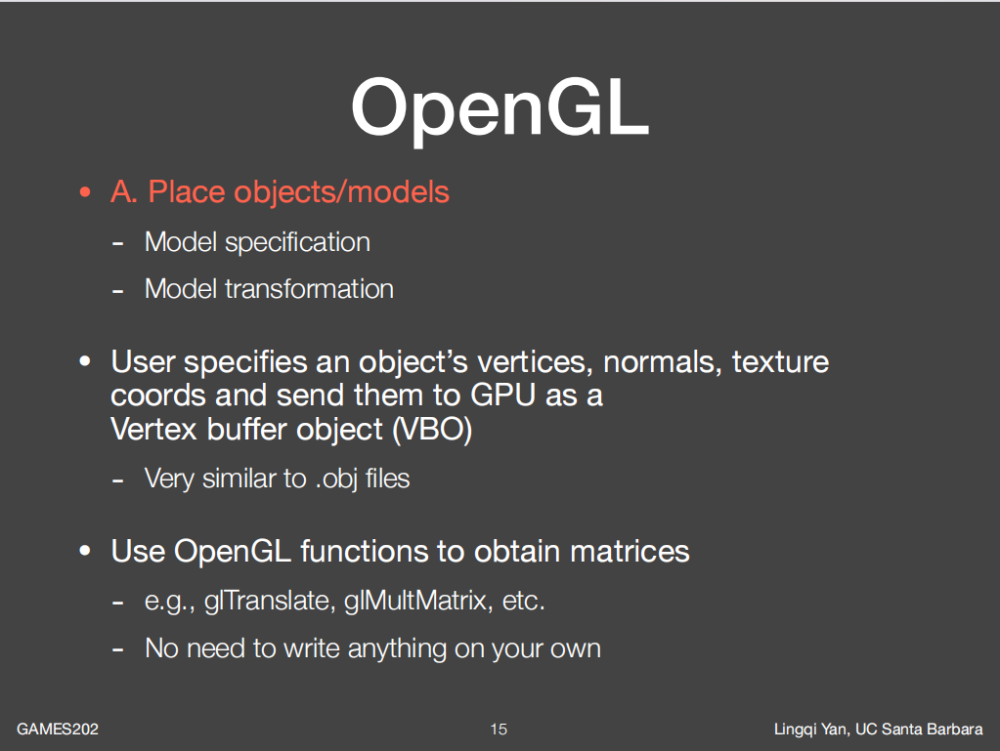
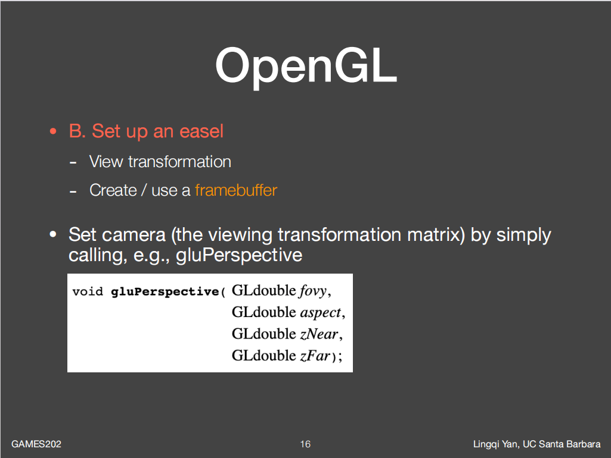
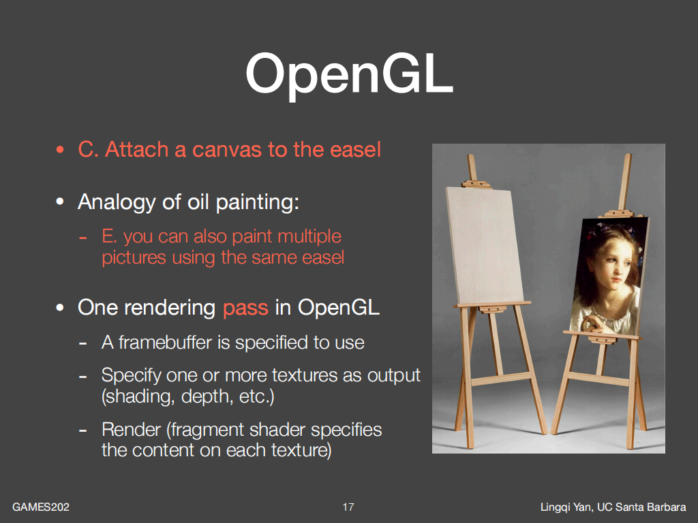
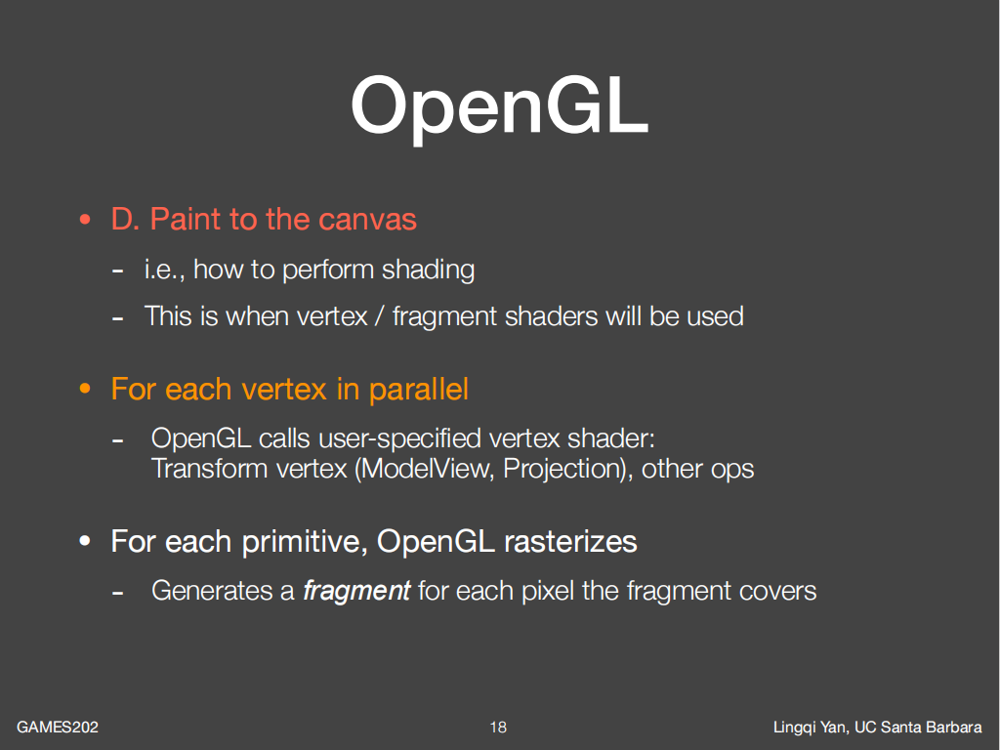
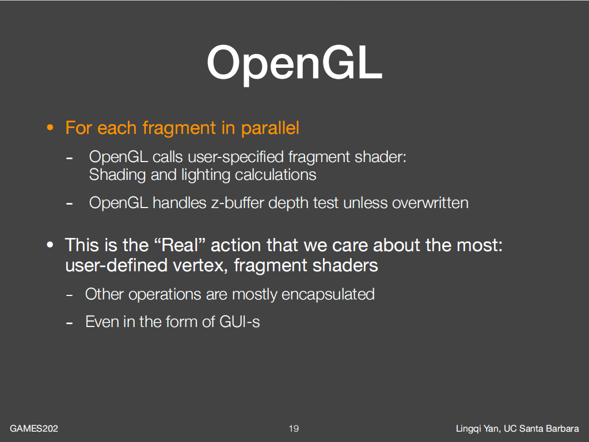
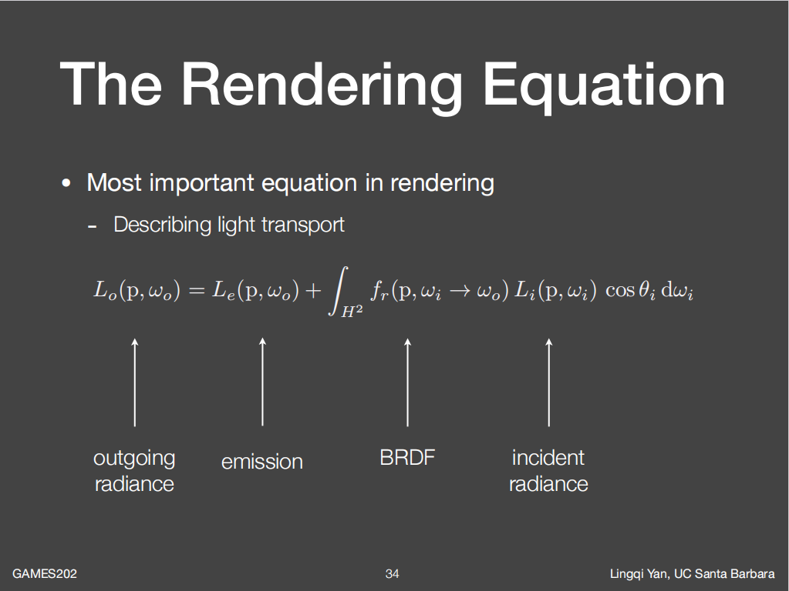
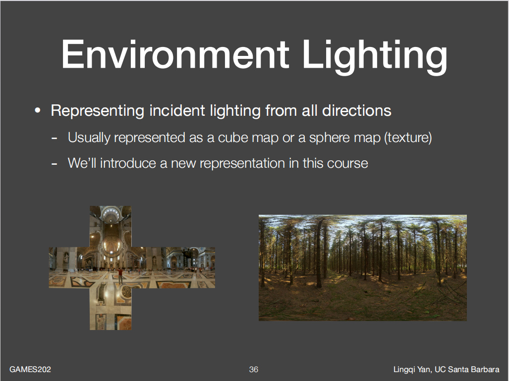

# 图形渲染管线

图形渲染管线：将输入的顶点信息经过一系列的处理最终转化为像素呈现在屏幕上。

## 应用阶段

CPU处理的部分。处理顶点的信息(位置、法线、材质......)，并且由CPU决定将哪些数据传给GPU，譬如渲染目标场景中的灯光、场景的模型、摄像机的位置。也可以执行视锥剔除，将在视锥体外的物体(三角形)剔除，并且告诉GPU这些数据的渲染状态(譬如纹理、材质、着色器等)。并且将处理后的数据从内存放入显存，并调用Drawcall让GPU工作。

## 几何过程

几何过程可以分为两个部分，顶点过程和三角形过程，狭义地说，几何过程就是指三角形过程。

顶点过程就是顶点着色器的部分，是可以完全由开发者控制的阶段。顶点着色器最基本的功能就是完成顶点从模型空间到裁剪空间的转换，但是从裁剪空间到屏幕空间的转换是不可控的。同时顶点着色器中可以改变顶点的坐标，用来实现一些与顶点位置相关的动画效果。顶点着色器也可以用来实现Flat Shading和Gouraud Shading这些简单的着色模型。计算顶点的法线和纹理坐标也是这个阶段的工作。

三角形过程也一般认为是狭义上的几何过程。这个阶段有几个可选的可编程着色器。
第一个是细分着色器Tessellation Shader，效果上来看就是增加更多的顶点，使得曲面的划分更加细致。在进入Tessellation Stage之前，流水线还将经过Hull-Shader，开发者可以指挥GPU如何进行细分，但不会真的进行操作。实际上开发者可编程的Hull Shader，但是真正执行细分操作是在Tessellation Shader，GPU根据Hull Shader来执行细分操作。在Tessellation Shader之后，有可编程的Domain Shader，用于对细分出来的新顶点进行坐标计算。到这里算是整个细分着色器的流程。
然后是几何着色器。开发者可以控制GPU对顶点进行增删改操作。实际上几何着色器也能执行顶点着色器的大部分功能，但是几何着色器的并行效率很低，所以一般只用来执行顶点的增删改这些只有几何着色器能实现的操作。*Vulkan编程指南*中说几何着色器只在Intel集显有不错的性能，所以现在很少使用。

几何阶段最后对裁剪空间中的图元做裁剪。整个图元在外时可丢弃，跨过边界时要在边界上求出新的顶点。像素和片元在后面的光栅化阶段才生成。

## 光栅化

光栅化阶段也可以分成两部分。图元装配和三角形遍历。

图元装配，有时候称为三角形设置，功能就是把顶点之间相连，组成各种图元(线、三角形或者有些时候可以是四边形)，计算出图元的各种重要数据(边或者线的方程，深度值等)，这些数据也可以用于着色的插值。

三角形遍历阶段。最重要的就是检验屏幕上的像素是否被三角形覆盖并生成片元，覆盖的模式有三种，覆盖中心点算覆盖，全部覆盖算覆盖和只要覆盖到一点就算覆盖。片元与像素的差别在于片元是包含了很多种状态的集合(譬如屏幕坐标、深度、法线、纹理等)，这些状态用于最终计算出每个像素的颜色。

覆盖区域内还要计算片元的深度。符合条件时，GPU 可以在片元着色前提早做深度测试，这就是 Early-Z。

MSAA 在光栅化时为像素取多个覆盖样本，各样本可以分别做深度测试。延迟渲染也能使用 MSAA，但要处理多样本 G-buffer，开销更高。

## 片段着色器

简单地说，就是计算每个片段的颜色的阶段。执行光照计算之类的，同时应用各种贴图也是这个阶段。

Framebuffer 操作包括深度和模板测试、颜色混合以及写入。后处理通常另做一个或多个 pass，用已渲染的图像作为输入。

## 色彩混合

对每个片元进行操作，将它们的颜色以某种形式合并，得到最终在屏幕上像素显示的颜色。主要的工作有两个：对片元进行测试（Test）并进行合并。

这一步一般而言有四个测试。按顺序

剪裁矩形测试（scissor test）丢弃落在指定矩形之外的片元。视锥体裁剪处理的是更早阶段的图元。

透明度测试：设定一个透明度的阈值。大于这个值可以绘制，小于这个值就不用绘制了。透明度测试的物体在不透明物体之后半透明物体之前进行绘制。

模板测试：在模板测试中，GPU将读取片元的模板值与模板缓冲区的模板值进行比较，如何比较可以由程序员决定，如果比较不通过，这个片元将被舍弃。

深度测试会根据设定的比较规则处理被遮挡的片元。允许提前测试时，可以在片元着色前用 Early-Z 剔除它们。

# OpenGL

利用 VBO 存储顶点数据，用 VAO 记录顶点属性的布局和缓冲绑定。在现代 OpenGL 的核心模式下，应用自己构造变换矩阵，并传入着色器。

然后就是视图变换，并创建帧缓冲。

帧缓冲可以挂载多张纹理，也可以渲染到用于显示的默认帧缓冲。画面是否撕裂取决于交换缓冲时与显示器扫描的同步。

顶点着色器和片段着色器。

顶点着色器执行顶点的一些变换。然后光栅化阶段生成片段。

片段着色器执行每一个片段的着色。

总而言之，OpenGL就是告诉GPU要做什么。

# 渲染方程

**p**：渲染的位置。**ωo**：出射光方向。**ωi**：入射光方向。*θi*：入射光方向与法向量的夹角。**L0**：输出的Radiance。**Le**：自发光。*fr*：BRDF。**Li**：入射光(间接光照)的radiance。

# 环境光

用来表示间接光照。可以是cube map，也可以是球。其实应该用辐照度图。。。