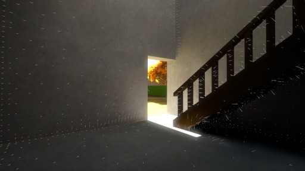
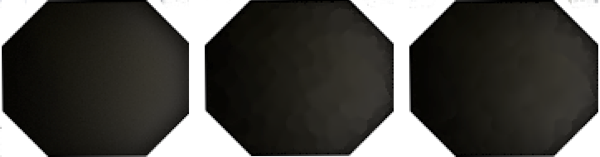
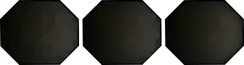
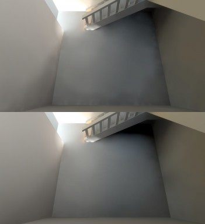

> 因为十分喜欢《见证者》，所以想试着翻译一下他们的技术博客。
>
> 总之它们博客上Engine Tech这个tag里的更新基本上都在2010年到2014年，所以这里面的技术很大可能都已经落后了，突出一个学了可能没啥用。当然如果能启发到您那是最好了，然而比起我这不如AI的翻译，更建议看原文捏。特别是GI相关的这几篇，翻译得尤其糟糕捏。
>
> 是我最爱的全局光照捏。
>
> 博客链接：http://the-witness.net/news/category/engine-tech
>
> 原文链接：[Irradiance Caching – Part 1](http://the-witness.net/news/2011/07/irradiance-caching-part-1/)
>
> 作者： Ignacio Castaño

这是我在开始写《见证者》背后的技术时第一篇想要发布的文章。我花了一周实现了带有旋转和平移梯度的irradiance缓存。将梯度估计方程扩展到半立方体采样分布被证明是有难度的，这耗费了我大量的精力。因此我觉得把我的推导写成文档会很酷，这样将来其他人就不需要再重复这些工作了。但是，为了让这篇文章更易于理解，我必须提供一些背景，可以在下面这两篇之前的文章中查看：

+ [Lightmap Parameterization](http://the-witness.net/news/?p=120)
+ [Hemicube Rendering and Integration](http://the-witness.net/news/?p=244)

不巧的是，就在我完成这两篇文章的时候，我做的梯度相关的工作已经有些过时了，这也是我在这篇文章上花了这么长时间的原因。



在我之前关于半立方体渲染和积分的那篇推送中，我提到了我们需要能找到一个算法，能让我们可以外推irradiance以填充lightmap上采样点无效的那些像素，能平滑结果生成的lightmap以降低噪声，并且能以更低的频率采样去采样irradiance来提升性能表现。热心读者建议我使用irradiance缓存，可以解决所有的问题。但是当时我并不知道这个，所以我最初的解决方案算是误入歧途。

## 纹理空间的方法

我有一些制作用于从高分辨率网格捕获法线贴图和位移贴图的烘焙工具的经验。在此背景下，使用各种图片滤波器填充采样瑕疵产生的孔洞，并且将采样的属性扩展到网格参数化的边界之外。Hugo Elias的那篇热门的文章中也提出了一种纹理空间的分层次采样的方法，并且这说服了我使用纹理空间的方法是好主意。

然而，在实践中，纹理空间的方法暴露了许多的问题。外推的滤波器提供的估算值只有在图表边界附近才准确，甚至更糟糕的是，它们只使用边界一侧的信息，导致结果常常出现接缝。另外，不规则采样和插值的效率也因为纹理的不连续性而大幅下降，所以采样数的降低远不及预期。

在尝试各种方法之后，由工作在物体空间（译：object space，是什么？）的解决方案代替在纹理空间中的方法开始变得明确了。正当我决定实现自己的解决方案时，才知道这就是irradiance缓存相关的技术。

## irradiance缓存技术

这个技术的名字太糟糕了，以至于在我听到朋友的建议之前完全没有听说过它。我想自适应irradiance采样或者irradiance插值会是更加合适的名字。事实上在[第一个提出这个技术的论文](http://radsite.lbl.gov/radiance/papers/sg88/paper.html)中，作者Greg Ward将这项技术称为“惰性irradiance评估(lazy irradiance evaluation)”，这个名字显然合适。

关于这个主题已经有大量的文献，我也不想复读那些能从别的地方轻松学到的东西。因此在这篇文章中我只打算提供一个简要的概述，更多地聚焦于我们自己的实现中独特的一些东西，并且指出一些你能进一步参考的一些文献。

辐照度缓存会依据光照变化的快慢，自适应选择采样位置。这里用分裂球体（split sphere）模型近似较不利的照明情况，根据采样点到附近几何的距离估算采样间隔。

接下来是通过使用径向基函数(radial basis functions)来执行采样点之间的插值。与每个采样关联的半径同样基于这个距离。一旦附近的某个采样值的贡献降低到低于阈值，就生成一个新的irradiance记录，在我们的案例中，这是通过在那个位置渲染一个半立方体实现的。为了更高效地执行插值，irradiance记录用八叉树(octree)组织，可以让我们更加高效地查询与任意一点邻近的记录。

如果你想要更多细节，[Siggraph &#39;08 course](http://cgg.mff.cuni.cz/~jaroslav/papers/2008-irradiance_caching_class/index.htm)是这个主题最全面的参考资料。有一本基于这个课程的材料的书，稍微优化了一些地方，但是在我看来，并没有在免费的材料中增加了许多有价值的东西。

pbrt这本书是非常好的资源，而且附带的源码包含了一个虽然基础但是很好的实现。

最后，Rory Driscoll提供了一个优秀的程序员视角的介绍：[part1](http://www.rorydriscoll.com/2009/01/18/irradiance-caching-part-1/)、[part2](http://www.rorydriscoll.com/2009/01/24/irradiance-caching-part-2/)。

我们的实现非常的常规，然而依然有两个主要的差别：第一，我们使用半立方体来采样irradiance，而不是分层蒙特卡洛分布(stratified Montecarlo distribution)。导致我们在计算用于插值的irradiance梯度时会有一些差异。第二，我们使用了更适合我们项目的记录布置策略。在part1这篇文章中，我会聚焦于irradiance梯度的估算，而在之后part2的文章中，我会介绍我们的记录布置策略。

## Irradiance梯度

对离散辐照度样本插值时，结果容易出现斑点。增加采样数并放宽插值条件，可以让更多记录的覆盖范围重叠，结果也更平滑。代价是采样开销随之增加，削弱了缓存的加速效果。

提高插值效果最有效的方法之一是在采样点估算irradiance的梯度，这能告诉我们当表面的位置和朝向变化时irradiance是怎么变化的。我们不能精确地评估irradiance梯度的值，但通过我们在渲染半立方体时获得的信息可以找到合理的近似。

在我之前的文章中，我解释了irradiance的积分只是仅仅将radiance的采样加权求和。其中每个样本的贡献是每个半立方体的像素的radiance <em>Li</em>和这个像素的立体角<em>Ai</em>以及余弦项<em>cosθi</em>这三项的乘积。也就是说，点<b>x</b>的irradiance <em>E</em>(<b>x</b>)的近似值如下：

$$
E(\mathbf{x}) \simeq \sum_{i=0}^N A_i L_i \cos\theta_i
$$

irradiance梯度需要考虑的是这些项在无穷小的旋转和平移下的变化，通过对<em>E</em>(<b>x</b>)微分可得：

$$
\nabla E(\mathbf{x}) \simeq \sum_{i=0}^N \nabla\!\left(A_i L_i \cos\theta_i\right)
$$

在局部估算中，把各样本的辐亮度视作固定值，可以简化为下式。

$$
\nabla E(\mathbf{x}) \simeq \sum_{i=0}^N L_i\nabla\!\left(A_i\cos\theta_i\right)
$$

现实中，radiance的值并不是真的是常数，但我们的目标是估算梯度而不使用除了我们从将场景渲染到半立方体时获得的信息以外的任何的额外的信息。因此我们能仅仅在给半立方体做积分时顺便做一些额外的计算就能提高插值的质量。。

## 旋转梯度

旋转梯度表示了半立方体在任意方向发生旋转时irradiance是如何变化的：

$$
\nabla_r E(\mathbf{x}) \simeq \sum_{i=0}^N L_i\nabla_r\!\left(A_i\cos\theta_i\right)
$$

观察能得到的最重要的发现是，当半立方体旋转时，像素相对于原点的立体角保持为一个常数。因此，影响梯度的唯一因素就是余弦项了：

$$
\nabla_r\!\left(A_i\cos\theta_i\right) = A_i \nabla_r \cos\theta_i
$$

记住这点，旋转梯度只是被变化率缩放的旋转轴，也就是说，角度的梯度是：

$$
\frac{\partial}{\partial \theta_i}\cos\theta_i = -\sin\theta_i
$$

旋转轴由表面法线方向 $\hat{\mathbf z}=(0,0,1)$ 与纹素方向 $\mathbf d_i$ 的叉积归一化得到。两者平行时，该样本的旋转梯度为零。

$$
\mathbf{v}_i=\frac{\hat{\mathbf z}\times\mathbf d_i}{\lVert\hat{\mathbf z}\times\mathbf d_i\rVert}
$$

因此：

$$
\nabla_r \cos\theta_i=-\mathbf v_i\sin\theta_i
$$

对于单位方向，$\sin\theta_i$ 就是归一化前的叉积长度，所以可以继续化简。

$$
\nabla_r \cos\theta_i = (\mathbf{d}_{yi}, -\mathbf{d}_{xi}, 0)
$$

最终，半球的旋转梯度为各像素梯度的累加：

$$
\nabla E(\mathbf{x}) \simeq \sum_{i=0}^N L_i A_i (\mathbf{d}_{yi}, -\mathbf{d}_{xi}, 0)
$$

最终的代码十分简单：

```cpp
foreach texel, color in hemicube {
    Vector2 v = texel.solid_angle * Vector2(texel.dir.y, -texel.dir.x);
    rotation_gradient[0] += v * color.x;
    rotation_gradient[1] += v * color.y;
    rotation_gradient[2] += v * color.z;
}
```

## 位移梯度

位移梯度的推导会比旋转梯度复杂不少，因为在位移时，立体角不再是不变的。

我最初的方法是使用更容易微分的近似替代立体角项。对比之前使用的精确的像素的立体角，我使用被像素的固定面积缩放的微分立体角来获得它的近似，如果纹理的像素足够小，这个近似就是合理的。

通常给定方向Θ的微分立体角是：

$$
d\omega_{\Theta}=\frac{\mathbf{n}\cdot\Theta}{r^2}da
$$

对于那些在半立方体顶面的像素，<b>n</b>与z轴方向是相等的，所以这种情况微分立体角为：

$$
d\omega_{\Theta}=\frac{\cos\theta}{r^2}da
$$

另外我们也清楚：

$$
\cos\theta=\frac{1}{r}
$$

所以可以进一步简化表达式：

$$
d\omega_{\Theta}=(\cos\theta)^3da
$$

使用这个结果，并且把像素的面积提取到求和之外，我们能得到下面这个计算梯度的表达式：

$$
\nabla_tE_z(\mathbf{x}) \simeq 4\sum_{i=0}^N L_i\nabla_t(\cos\theta_i)^4
$$

其余的面也有类似的表达式，会稍微复杂一些，但依然在x和y方向上容易微分。我们也可以继续在这个方向上走下去，也能找到可以估算位移梯度的接近的方程。然而，这个简单的方法不能产生令人满意的效果。问题在于这个方法假设了位移时唯一发生改变的量是像素的投影的立体角，但是它忽视了相邻的像素之间的视差效应(parallax effect)和遮挡。也就是说，那些靠近半立方体来源的物体的采样会比那些离得远的移动得更快，并且它们移动时也可能会遮挡到附近的采样。

如下面几张lightmap所示，使用这些梯度值的得到的结果在远离遮挡物时会相对比较平滑，但在靠近遮挡物时会产生不正确的结果。

<em>最左是用于参考的，中间是没有使用梯度的irradiance缓存，最右是使用现在有缺陷的梯度的irradiance缓存。</em>

六边形对应房间的天花板，这个房间的两侧由墙壁和一扇窗户，光线可以通过窗户进入房间。图片的左侧用于参考，每个像素有一个半立方体采样。图片的中央是用irradiance缓存并且只用了2%的采样数计算的相同的lightmap。注意采样数是为了更加突出瑕疵故意降到这么低的。图片的右侧是用之前提出的梯度计算方法计算出的相同的lightmap，如果你靠近看，能看出在这张lightmap靠内部的位置看上去比较平滑，但是靠近墙的位置瑕疵依然存在。

这与Krivanek等人在[Radiance Caching for Efficient Global Illumination Computation](http://cgg.mff.cuni.cz/~jaroslav/papers/tvcg2005/krivanek05radiance_caching.pdf)中提出的梯度计算的缺陷是完全相同的。但他们在后来的[Improved Radiance Gradient Computation](http://cgg.mff.cuni.cz/~jaroslav/papers/sccg2005/sccg2005-krivanek.pdf)中纠正了，使用的方法就是用Greg Ward在最初的[original Irradiance Gradients paper](http://radsite.lbl.gov/radiance/papers/erw92/paper.pdf)中使用的相同的处理问题的方法。

然后我就尝试了下面的相同的方法：基本思想考虑位移时余弦项是不变的，这样的话就只剩下面积项需要求微分了，并且用邻接单元格之间的边缘面积变化量来表示单元面积的梯度。最重要的发现是：相邻单元间边界的移动始终由最近的采样点决定，因此这种方法将遮挡纳入了计算中。

不幸的是，我们不能直接使用Greg Ward的方法，因为这个方法是个分层蒙特卡洛分布紧密联系的，但我们使用的是半立方体采样。不过，我们依然可以应用相同的方法论来得到我们的情况下能使用的梯度计算方程。

在我们的案例中，每个单元是半立方体投影到半球球面上，而单元面积是像素的立体角。确定像素的立体角的位移梯度是等价于计算像素的每条边(wall)对应的边际梯度(marginal gradients)的和。

这些边际梯度是将边的法线投影到位移平面，将投影结果按边的长度缩放，再乘以边在该方向上的移动的速率(rate of motion)。

半立方体使用心射投影（gnomonic projection）。纹素的直边会投影为球面上的大圆弧。由边的两个端点对应的单位方向 $\mathbf d_0$ 和 $\mathbf d_1$ 可以求出弧长。

$$
\operatorname{arclength}(\mathbf d_0,\mathbf d_1)=\arccos(\mathbf d_0\cdot\mathbf d_1)
$$

剩下的问题就是计算边(wall)的运动速率，正如Greg Ward指出的，这个速率必须与两个采样点的最小距离成一定比例。

半立方体的边可按所用的局部球坐标近似为两类。下面分别考虑极角 $\theta$ 固定和方位角 $\phi$ 固定的情形。

这其中的任意一种情况，我们都可以通过考虑[规范半球参数化](http://mathworld.wolfram.com/SphericalCoordinates.html)中的类似问题估算边沿着法线方向的变化率：

$$
\begin{aligned} r&=\sqrt{x^2+y^2+z^2} \\
\phi&=\operatorname{atan2}(y,x) \\
\theta&=\arccos\frac{z}{r} \end{aligned}
$$

 对于经度边，我们可以考虑沿着x轴运动时<em>θ</em>是怎么变化的：

$$
\frac{\partial \theta}{\partial x} = -\frac{\cos\theta}{r}
$$

而对于纬度边，我可以考虑沿着y轴运动时<em>Φ</em>是怎么变化的：

$$
\frac{\partial \phi}{\partial y} = \frac{-1}{r \sin\theta}
$$

正如我们之前所描述的，运动速率是被最近的样本主导的，所以<em>r</em>的值取与边邻接的最近的两个采样点中最小的深度值。

这些方程详细的推导可以在[Wojciech Jarosz&#39;s dissertation](http://zurich.disneyresearch.com/~wjarosz/publications/dissertation/)中找到。他的细节解释十分口语化，所以我十分推荐去阅读一下，以对这些方程的推导有更深入的认识。

如下图所示，新的梯度生产出了更好的结果。注意三张lightmap靠近内部的部分看上去基本是相同的，但是靠近墙的部分，新的结果要平滑很多。但是瑕疵依然存在，因为采样数被人为地控制得很低。

左边没有应用梯度，中间使用是之前有缺陷的梯度的，右边是使用新的加强版的梯度的

为了高效地估算位移梯度，我们预计算了各个像素边(edge)对应的边际梯度(marginal gradients)的方向和模(magnitude，大概就是长度吧，或者说大小)，而不需要将到边的距离放到计算中：

```cpp
// Compute the length of the edge walls multiplied by the rate of motion
// with respect to motion in the normal direction
foreach edge in hemicube {
    float wall_length = acos(dot(d0, d1));
    Vector2 projected_wall_normal = normalize(cross(d0, d1).xy);
    float motion_rate = (constant_altitude(d0,d1) ?
        -cos_theta(d0,d1) :      // d(theta)/dx = -cos(theta) / depth
        -1 / sin_theta(d0,d1);   // d(phi)/dy = -1 / (sin(theta) * depth)
 
    edge.translation_gradient = projected_wall_normal * wall_length * motion_rate;
}
```

然后在积分的时候，我们将计算的过程分成两步。首先，我们将半立方体的每条边被边之间的最小距离缩放后的边际梯度累加：

```cpp
foreach edge in hemicube {
    float depth0 = depth(edge.x0, edge.y0);
    float depth1 = depth(edge.x1, edge.y1);
    float min_depth = min(depth0, depth1);
 
    texel[edge.x0, edge.y0].translation_gradient -= edge.gradient / min_depth;
    texel[edge.x1, edge.y1].translation_gradient += edge.gradient / min_depth;
}
```

当我们有了每个像素的梯度，就可以计算最后的irradiance梯度，就是所有的像素的梯度的加权求和，权重是像素的颜色。

```cpp
foreach texel, color in hemicube {
    Vector2 translation_gradient = texel.translation_gradient * texel.clamped_cosine;
    translation_gradient_sum[0] += translation_gradient * color.x;
    translation_gradient_sum[1] += translation_gradient * color.y;
    translation_gradient_sum[2] += translation_gradient * color.z;
}
```

## 结论

irradiance缓存给我们的lightmap烘焙器提供了非常可观的加速。在典型的网格体上，只需要渲染10%到20%的采样就能估算出非常高质量的irradiance。而对于质量稍低的结果或者快速预览，我们只需要低至3%的采样数。

在插值中使用irradiance梯度可以显著地减少采样数，或者使用相同的采样数时能获得高得多的质量的结果。下面的图片对比了有没有使用irradiance梯度的情况，两种情形中采样数和位置都是相同的，注意下面的图如何具有平滑得多的lightmap。


我认为在没有irradiance缓存的情况下，使用半立方体渲染的全局光照方法是不切实际的。也就是说实现健壮的irradiance缓存是困难的，需要大量的调试和参数调整，才能产出较好的结果。
